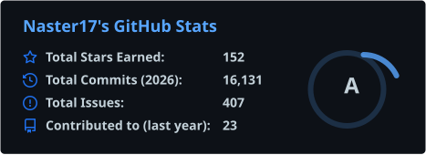
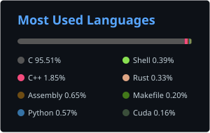

# Hi there! I'm Naster17 👋

Minimalistic low lvl developer.  
I am interested in software and hardware.  
In the past, I am in cybersecurity and penetration testing.  
Telegram channel https://t.me/naster17dev  
Also see my personal blog https://naster17.xyz/  

## My favorite tools and technologies ⚙️

-------------------

